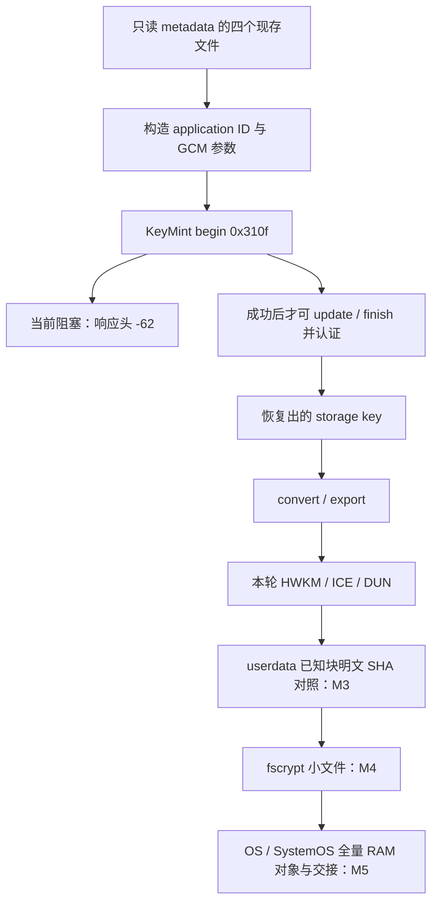

# fuxi UEFI metadata 密钥恢复：-62 全链路调查报告与独立静态研究说明

**证据截止：2026-10-30 23:35，Asia/Shanghai。** 本文面向没有参与前面对话的分析者。
整理基线为 UEFI 仓库 `fc598637388a40728d21d30ad5330aff6fde75ac`、设备日志仓库
`9ae50c30b09dcea9a322c6b57df02c19514d7b7a`。本文整理已有结果，没有新增手机实验。

## 1. 先读结论与尚未解决的问题

**实机稳定现象是：public configure 被接受后，第一条现存 metadata 包裹键的
begin 仍返回响应头 `0xFFFFFFC2`，按 int32 为 -62；没有获得 operation handle 或恢复输出。**
标准 KeyMint 语义将 -62 称为 `KEY_REQUIRES_UPGRADE`，但名字不等于已经定位本机
产生它的代码分支，更不自动授权升级既有键。

目前最关键的事实：

1. 未配置的旧候选先观察到 -64；加入已验证的 `0x2116` 三字段配置后，观察到 -62。
2. 将 OS/vendor 配置日期从 `20261005` 改为 TWRP 可见的 `20991231`，两次独立启动
   均得到 -62。两组都没有独立控制 boot patch，也没有直接读出 TA 的实际槽值。
3. 固定 TA 有 begin → 解包 → 版本校验的直接调用链；版本函数存在旧格式和字段
   不匹配两类显式 -62 返回点。认证辅助函数也可能传播负状态，不能穷尽为只有两个来源。
4. 后来读取的未认证公开外层格式已经是 `0x400000005`；其 OS/补丁整数与候选有
   可复现的差异。但该快照与先前 A/B 实际输入逐字节相同没有证明。
5. boot 比较值来自独立上下文，三字段 configure 不设置它。映像初值、ABL 局部转换、
   SDK 函数返回值和实际安全世界运行值必须区分。
6. 最新修正 lookup 格式后，**不经本候选 loadFromBuffer 就能查到 keymaster64 对象引用**；
   对象/架构校验和完整有限清理已实机通过。它没有调用 KeyMint 方法，更未重试 -62。
7. 实际 -62 返回 PC、当时认证后的 blob 字段、TA 实际版本上下文和与 ABL 的底层实例
   关联仍未捕获。**M3、M4、M5 均未通过。**

整晚分析的目标是减少这些未知，给出带固定输入、精确地址、前提和反例的解释。
不能把“某种合成状态可复现 -62”写成“实机根因已确定”。静态分析确实可能无法
唯一判定历史实机分支；此时应交付不可区分的候选集合及最小新增观测方案。

### 证据等级

| 标记 | 含义 | 能支持什么 |
|---|---|---|
| D | 实机照片或稳定的设备只读采集 | 本次启动/采集确实看见的字段和行为 |
| S | 固定二进制的机器码、表项、重定位、源码数据流 | 该输入存在某路径；不证明设备走过 |
| M | 主机私有内存中的受限指令模拟或合成 monitor 测试 | 明确模型/入口/停止点下的行为与反例 |
| H | 推测或待验证解释 | 只作为调查方向，不能作为后续推导中的事实 |

下文“通过”均限定到具体观察；初始化、认证、装钥和解密不能互相替代。

## 2. 工程目标、-62 所在位置与只读边界

设备为小米 13 fuxi / SM8550，已解锁，设备标识 `fcde91e`。本问题属于 B 线
`feat/twrp-data-uefi`：UEFI 自己只读 Android `/data`，得到精确 OS/SystemOS 文件明文，
全量 SHA256 后发布既有 RAM 对象协议，再经原菜单、DarwinBoot 进入 XNU。
A 线 USB RAM 引导是另一条线，不能以其进展代替 B 线验收。

最终两个协议对象的长度分别为OS 6,077,580,800字节、SystemOS 3,303,014,400字节，
还绑定地址和完整SHA256。解决-62只是其前置依赖中的一环，不是“大文件免USB重传”验收。

M1 原始 UFS 有界读取、M2 `/metadata` 已知文件哈希已有实机证据。M3 需要进一步完成
安全初始化、现存 storage key 恢复/转换、本轮 HWKM/ICE 槽和 DUN、userdata 已知元数据块
明文对照；其后才是 M4 fscrypt 文件明文和 M5 两个大对象交接。



`keymaster_key_blob` 是用于恢复操作的包裹键 blob，不是已经恢复的 storage key，不能
直接拿它当 convert 输入。当前 -62 阻断既有实现中的首条 begin，不能忽略错误后继续。
至于本机是否必须在正常平台初始化后进行合法升级、或应直接接受原键，尚待分析；
当前只读恢复子集没有升级/生成/写回接口。

夜间任务只做主机离线分析：不连接/重启手机，不运行 ADB/fastboot，不发送安全命令，
不构建或上机，不运行 Android `.so`/Linux `.ko` 的原生服务，不导出秘密材料。
发现疑似修复时提交独立建议/补丁文件，留待审阅，不能删除保护或偷偷改变分析基线。

## 3. 实验演进：哪些观察有效，哪些已经更正

| 阶段 | 实机/静态结果 | 解释与边界 |
|---|---|---|
| 旧 loader lookup，10-28 | 旧 `0x1001` 查询 keymaster64/keymaster 得对象层错误 2 | 不能证明 TA 不存在；当前部署契约后来发现不同 |
| load / getVersion / date-support | 可返回 App，版本原始四字段 `[4,1,4,1012]`，date-support=1 | 不证明 boot 已设置、完整初始化或键可恢复 |
| 历史 setVersion | `0x3121`、整数十进制200的请求返回 wrapper `FFFFFFD8` (-40) | 固定 TA 的89项表无该命令；不以数字名字猜标签错误或改成相邻命令 |
| live-v1 | 首条 begin 后 Not Ready / retained1，缺具体响应头 | 不能从 km0 推断 TA 成功，也不能由 fault7 猜具体错误 |
| status-v2，10-30 12:00 | 首条 begin 响应头 `FFFFFFC0` (-64)，payload40616 / wire40624 | 与未配置门相符；配置后能否成功仍未知 |
| configured-v3，两次独立启动 | configure status0；begin `FFFFFFC2` (-62)，commands1 / resumes1 / retained1 | -64 后已推进到另一错误；没有 operation handle 或输出 |
| v4–v6 特性探针 | 历史出现 -33/-62，但失败后保留与入口门控有缺陷 | 不作为可靠的新调用序列/隔离验收；部分旧推断已撤回 |
| characteristics-isolation-v1 | 特性查询 -33 后跳过 begin，attempted0 / retained1 / PARK | 修复失败后不继续和不擦注册页；-33 本身不是 -62 的已证根因 |
| TWRP 上下文，16:28 | 补丁属性2099-12-31；进程/库匹配；state2/空seed向量 | 属性不是构造时采样轨迹，更不是 TA 槽值 |
| configure A，17:00 | 20261005配置成功，首条恢复 -62 | 原始响应/长度与隔离归档 |
| configure B，19:54 | 20991231配置成功，首条恢复同为 -62 | 单改这两个公开日期没有解除错误；不能唯一归因 |
| 公开外层读取，20:22 | 格式0x400000005、OS170000、OS patch202610、vendor20260801、boot202610 | 未认证；与历史 A/B 实际输入的等价性未证明 |
| 固件身份，22:31 | 当前slot A ABL/TZ与本地ROM补零后匹配 | 分区身份不等于加载RAM、实际参数来源或实例身份 |
| 修正 lookup，23:35 | `0x1011`/BO4返回对象4、arch2，release/delete成功，retained0/PARK | 新格式有限查询与清理实机通过；没有调用版本/恢复方法 |

旧文档经常保留“尚未上机/尚未实现”的早期正文，后面追加最终结果。阅读时必须看
同页追加、更晚专题和候选 REVIEW，不能把一页开头冻结为当前结论。

### 关键镜像与历史源码

| 候选 | SHA256 | 来源与资格 |
|---|---|---|
| status-v2 | `c32884767117277ff89beb68b2fe2c4eedb6b7e675805ad0eafaf908320fc83e` | 27资格、76源；-64实机头 |
| configured-v3 | `5620674f194370b0ac480296c0df4986d28af1ba6c0d2fdee0894608e5f01888` | 28资格、81源；两次-62 |
| configure A | `169e7401d2fa3fcce8347f50232b253c11bf884773b474fb2365b3b52185e44b` | 29资格、91源；源码09bc89e1d3dd733a30f86fca1e953a06ee11a36b |
| configure B | `81e1abd43ec63d27abd970be69943557d388b61e72ce6274f1684b9a977474f5` | 同一源码/资格；仅公开patch配置变量不同 |
| lookup-arch-v1 | `2c140f174ed784b398bbcd9cb3b73b09ea4cb484c87de53917c183366b75b542` | 21资格、96源、38新格式用例；源码530596c2ebf83dba03c04882b61ffc69609a5414 |

旧 A/B 的91项 `sources.json` 应与其历史提交逐项核对，**不能要求它们与已新增
lookup实现的当前树一致**。当前 lookup 的96项绑定也不能替旧 A/B 的实际对象背书。
完整资格退出码、编译对象、linked map和照片均在各候选独立 out 目录。

## 4. -62 的实际观察层：四类状态不能混读

### A/B 两组共同的最终字段（D）

```text
CONFIGURE: a0..a3=0; status=00000000; resumes=0
           payload=40912; wire=40920
RECOVERY: result=Not Ready; state=5; stage=1; km=0; bytes=0
          attempted=1; retained=1; fault=7; exchange=1
          commands=1; resumes=1
          response-header=1; status=FFFFFFC2
          payload-bytes=40616; wire-bytes=40624
final: PARK; handoff=0; UFS stop1/db0/tdb0/run0
```

| 层 | 本例含义 |
|---|---|
| SMC a0/a1/a2/a3 | 外层传输/响应类型/对象调用结果等；终结全0不等于内部密钥操作成功 |
| QSEE/TA wrapper `status` | 已经过边界检查的公开头 `FFFFFFC2`，这里才是本轮所说的 -62 |
| CBOR/operation reply | 本次没有接受有效 begin handle；不能凭 wrapper 头猜操作成功或已关闭 |
| UEFI本地 result/state/km/fault | 后端保守校验、恢复核心状态和默认字段；不与原始 TA status同义 |

生产 `M3KeyMintBackend.c::Call` 在验证描述符/输入/回调页/响应边界后记录公开头。
当 `TaStatus != 0` 且 `Payload != 0` 时进入 `fault=7` 隔离。A/B的40616恰为响应
容量减8，**不是恢复出的密钥长度**，也不能仅据它证明 TA 实际写出这些有效payload。
固定 deviceutils `sendCmd` 在非零status时直接返回，不按成功路径解释payload。
错误头的长度语义是可继续静态研究的地方，但不应先放宽当前归属保护。

因此这里 `state5=FkrQuarantined`、`stage1=FkrBegin`；`km0`是尚未接受为终结
KeyMint reply的默认值，不能覆盖原始-62。`exchange1=FseBound`也不是“传输错误1”。
`commands1/resumes1` 表示一条恢复命令有一次原SMC continuation，不是两个begin。
configure、getVersion和loader调用不计入这个恢复交换命令计数。

## 5. 两条调用链：UEFI直接子集与TWRP中间层

### 5.1 UEFI A/B 实际实现（S，核心顺序另有M）

```text
M1/M2 read-only /metadata preparation
  → FnuPrepareRecovery / FkrPrepare（四文件CPU副本、绑定证据）
  → UFS stop，确认有限队列状态
  → HLOS bridge / root register / open UID122
  → loadFromBuffer(keymaster64) → App
  → GetVersion 0x200
  → 一次 SmciConfigureRecovery 0x2116
  → FnuRunRecovery
      → FseInitialize(App, bridge, page)
      → FkmInitialize(App, FseExchange)
      → FkrRecoverExisting
          → Begin → FkmEncode → Call(0x310f)
          → FseExchange → 固定SMCI/缓存/同一次调用续接
          → wrapper status -62 / payload非零 → 后端fault7
          → 恢复核心隔离 → mRecoveryRetained
  → 跳过app/loader/env release和bridge delete → PARK
```

`M3SmciDiagnostic.inc`只load一次，所得同一 App 依次用于 GetVersion/configure/
recovery；`FseExchange`验证报文对象仍等于绑定App。源码和两日期54个合成场景/
52条批次轨迹验证了顺序、同App及隔离后无release/delete，不能冒充安全世界运行轨迹。

`SmciReleaseTaImage`在尾部擦除的是**CPU私有的原始TA输入镜像**，不等于卸载远端
App，也不是擦除仍隔离的注册共享页。把这两者混为一谈会误判生命周期缺陷。

### 5.2 TWRP 路线（S；缺少该键的真实运行轨迹）

```text
recovery retrieveKey / Keymaster::begin
  → Binder keystore2 createOperation（domain3/BLOB，namespace100）
  → KeyMint设备接口
  → libqtikeymint AndroidKeyMintDevice::begin
  → keymint_begin_operation（含spu_init等前置）
  → 0x310f + CBOR → QSEEComCompat / SMCI → TA
```

固定 recovery 的 metadata调用使用 `kEmptyAuthentication`。本机 Android vold
和后来的 TWRP recovery 有各自稳定的 state2/空seed向量证据；这支持候选的显式空seed
选择，但不是某个历史blob创建时应用绑定完全一致的证明。

固定 keystore2 在 `0x1115a4..0x1115c8`判断错误域/结果，匹配-62后可进入
`upgrade_keyblob_if_required_with: calling upgradeKey`关联路径，再重试操作闭包。
局部六组状态对照只有 `(1,1,-62)` 到升级入口；在入口停止，没有执行升级。
**代码存在不证明本机这次metadata键走过该路径。** TWRP能解密不能反推UEFI原始
begin必须直接成功，更不能直接移植升级和可能写回的retrieveOrGenerate分支。

## 6. 输入、绑定与wire：分析者需要区分的对象

### 四个现存metadata文件

路径根为 `/vold/metadata_encryption/key/`，处在 `/metadata` 的F2FS文件系统中。

| 文件 | 本机已观察大小 | 使用方式 |
|---|---:|---|
| version | 1字节 | 当前子集要求字节字符`1`，不是整数文件长度代表版本值 |
| secdiscardable | 16384 | personalized SHA512：补零到128字节的`Android secdiscardable SHA512`前缀，再接文件 |
| keymaster_key_blob | 208 | begin的包裹键blob；不是storage key |
| encrypted_key | 276 | 前12字节nonce，余下交给update/finish，含16字节GCM tag |

metadata使用空认证。候选application ID为64字节 personalized digest，加显式已核验的
seed；本轮选择空seed。GCM参数为 DECRYPT=1 / BLOCK_MODE GCM=32 / PADDING NONE=1 /
MAC_LENGTH128，tag含application ID `0x90000259`和nonce `0x900003e9`。
按当前长度关系，成功认证后的候选输出应为248字节；**本机尚未取得它**。

本报告/manifest不包含上述四文件原始材料、application ID、nonce、明文、密钥前缀
或其摘要。公开外层采集也不保存原始blob，只有白名单整数和读取边界。

### 固定A17 HAL的命令与编码（S/M）

| 方法/位置 | 固定调用选择 |
|---|---|
| AIDL begin `1b134 → 31dac / 31e5c` | `0x310f`，TA handler `0x8984` |
| update `1f58c → 3219c / 32268` | `0x3111`，handler `0x8fa8` |
| finish `1f8c8 → 32380 / 32430` | `0x3112`，handler `0x9350` |
| abort `1fa58 → 2fe28` | 非legacy TEE通用子集`0x2113`，handler `0x94f0` |
| public configure | `0x2116 → b7b4 → 37f28` |
| nonlegacy TEE upgrade | `0x2114`；没有接入UEFI |
| generate | `0x2108`；没有接入UEFI，不能误当upgrade |

begin CBOR map中label22为参数个数6，label23为blob；purpose参数为`0x20000001=1`。
厂商`addParams`通过`ldrsw`把32位tag扩成有符号64位label，application ID/nonce标签
实际编码为负整数。update为`{34:handle,35:bstr(input)}`，finish/abort为`{34:handle}`。
现有独立编码与厂商真实serializer做过12请求、3响应及完整SMCI模型对照，均仅合成输入。

QSEEComCompat外层object op0/counts `0x424`（BI4/BO2/OI4），四个input object为空。
固定SMC `x0=0x72000602,x1=0x224`；恢复输入报文`0x15000`、输出回调页`0x1000`，
共享视图合计`0x16000`。loader桥的注册范围在大候选中为`0x82000`，不是同一长度概念。
传输先做cache维护，保留返回x6对同一SMC最多续接8次；不支持任意安全调用。

生产相关文件、工具和固定哈希均列在本文配套manifest；分析需读实际代码，不能只读注释。
早期头文件“尚无生产调用者”等文字属于库创建时说明，现入口已经接线，历史正文不够新。

## 7. TA内直接链、显式-62分支与错误传播

以下地址都是固定TA的**ELF虚拟地址**，不能当文件偏移或手机运行时PC。
既有Unicorn工具另以`BASE=0x1000000`加载；反汇编地址必须按PT_LOAD换算。

```text
command 0x310f → handler 0x8984
  0x89e0 BL 0x35154
      0x352d8 BL 0x310a8
          0x310b4 B 0x31040
              0x31068 BL 0x30d9c
                  0x30e74 BL 0x304dc：公开授权map解码
                  → 算法查找/认证等辅助路径
                  0x31010 BL 0x98c0：版本校验
  解包错误先返回begin；成功后才可能进入后续操作函数指针
```

这推翻了旧“begin只能经8b1c/8db4间接回调到版本门”的说法。六条直接边已按机器码
验证。`0x3114`不是该链已确认的函数入口；objdump的最近符号标签不能替代函数边界。

| TA位置 | 已确认语义 | 尚缺条件 |
|---|---|---|
| `98c0`入口 | 结构`+1d4`非零（FBE相关内部标志）时局部门直接成功 | 不得伪造标志来过门；不代表认证/convert成功 |
| `dde0` | 返回最低格式`0x400000005` | 当前实际begin所见格式未直接捕获 |
| `9908` | 非上述标志路径，结构`+8`格式过旧，显式产生-62 | 没有实机PC证据 |
| `9944` | OS patch有效getter `b8ac`与结构`+14c`比较 | 实际上下文、认证后字段未知 |
| `994c` | OS getter `b82c`与结构`+144`比较 | 同上 |
| `9968` | boot getter `b850`与结构`+1c0`比较，受格式门约束 | 实际boot值未知 |
| `9970` | vendor getter `b940`与结构`+1b8`比较 | 实际vendor槽未知 |
| `9a1c` | 上述字段不匹配路径显式产生-62 | 无法由HLOS status唯一确定哪字段 |
| `30efc / 30f58` | 认证调用返回点的负状态可原样向上传播 | 注入-62仅证明传播，不证明真实认证函数会产生-62 |

已有模拟以公开合成envelope执行真实解码，在算法查找`0x25d4`之前停止；然后**单独
重入98c0**做版本门反事实。没有让真实blob认证成功，也没有把认证函数hook成成功。
完整调用图还需排查间接返回、辅助函数、错误映射与包装器，不能用“只搜到两条-62
立即数”穷尽全部来源。

## 8. 三种不同的版本信息：公开属性、blob字段、TA上下文

### 8.1 当前可用数值

| 域 | OS | OS patch | vendor patch | boot patch |
|---|---:|---:|---:|---:|
| A的configure原始整数 | 170000 | 20261005 | 20261005 | 没有该输入 |
| B的configure原始整数 | 170000 | 20991231 | 20991231 | 没有该输入 |
| A：局部真实getter、默认索引/未完整SDK | 170000 | 202610 | 20261005 | 模型中0 |
| B：同上 | 170000 | 209912 | 20991231 | 模型中0 |
| TWRP 20:22未认证hardware map | 170000 | 202610 | 20260801 | 202610 |

当前date-support=1模式下configure发送YYYYMMDD；`b8ac`对OS patch做月级规范化，
不能把20261005与202610直接判为错误。vendor与boot必须各自按本机实际getter研究，
不能推广OS patch的除100规则。

公开map的algorithm=32，software map为空，FBE tag未出现。存储表示中FBE相关tag
`0x700002d2`与请求参数域`0x70003f49`是两个编码域，不能混用或强加标志。

20:22有效采集只逐段读取208字节blob前142字节公开item，剩余66字节未请求。
两个稳定快照总284字节；初版未知外层整数曾误称flags，已清除并标无效，修正后重采。
有效采集不含原始前缀、未知整数或加密尾部。公开字段未认证，且与先前A/B输入相同
未证明；进入TWRP又是一次启动，不能倒填历史运行态。

### 8.2 已有反事实重放（M），不是实机归因

| 明确前提：当前公开整数、索引0、局部configure | 首个不匹配 | 局部门结果 |
|---|---|---|
| A，假设boot=0 | boot，9968 | -62 / 9a1c |
| B，假设boot=0 | OS patch，9944 | -62 / 9a1c |
| A，再假设boot匹配 | vendor，9970 | -62 / 9a1c |
| A，只让vendor匹配 | boot，9968 | -62 / 9a1c |
| A，同时假设boot/vendor匹配 | 无 | 0；只代表局部门 |

同一个-62/-62对照可由不同字段原因产生。当前公开格式达到最低值，使“当前这份
公开快照本身格式过旧”缺少支持，但不能彻底排除历史输入、认证后解析或其他传播路径。
匹配局部门也不代表 GCM finish、合法升级语义或真实恢复成功。

### 8.3 选择索引与独立boot槽（S/M）

TA GOT `0x5a308`的`R_AARCH64_RELATIVE`目标为RX常量`0x4c544=0`，不是任意可写
client ID；既有工具应用273个RELATIVE重定位并做RX写保护反例。该加载布局支持默认
索引0，但未完整覆盖安全加载器/SDK，不能擅称已捕获运行时client。

OS/vendor/OS patch访问器与选择槽有关；boot getter `b850`直接读独立`0x5b4f4`。
GetVersion和三字段configure都不写该boot槽。不要为了过门改RX索引、直接补全局或
按blob内容捏造平台初始化状态。

## 9. ABL / SDK 初始化：boot0和boot202607都尚非实机事实

### 9.1 三个容易混淆的“200/208”

| 名称 | 实际含义 |
|---|---|
| `0x200`（十进制512） | TA GetVersion，handler `ddf4`，查询四字段；不设置boot |
| 十进制200（`0xc8`） | 历史HAL setVersion请求`0x3121`的参数，不是GetVersion命令 |
| `0x208` | boot/context处理链，handler `bb7c`；有状态写入，不是只读查询 |
| 208字节blob | 文件长度；与命令`0x208`无这种数值等价关系 |

### 9.2 ABL来源选择与局部转换（S/M）

ABL可从vbmeta属性`com.android.build.boot.os_version/security_patch`取得字段，另有
Android boot头回退。A/B头均为boot v3、raw `0x220001a7`，即17.0.0 / **2026-07**。
更改后续public configure没有改变这个头，因此不是独立boot上下文A/B实验。

当前slot A ABL的PE地址：头回退`0x2cd24 → 0x2ce68`，启动入口调用
`0x2d0d0 → 0x41d28`，208构造`0x41f60..0x41fb0`，常量`0xa9da0=[0x208,0,16,48]`，
QSEECom发送跳板`0x423e0`。旧slot B ABL地址不同，不能交叉使用。

明确从“已选择头回退”的片段进入后，真实构造、TA边界解析和日期转换局部得到
OS170000 / boot202607；发送、平台前置和完整收尾均未执行。这没有证明实际启动选择
了此来源，也没有证明状态延续到UEFI的App。blob boot202610与局部202607不同只是
待核实线索，不能写成已定位根因。

### 9.3 TA和SDK初始化入口（S/M）

TA加载路径包含 `cmnlib_init → GPAppLib_init → 构造器数组 → GPAppLib_appInit → b490`。
构造器数组为空、本地b490不写boot，都不足以排除外部SDK/加载环境的影响。

匹配TZ内SDK模块基址为`0xd860f000`：

| 符号 | 模块相对地址 | TZ ELF VA |
|---|---|---|
| cmnlib_init | 3178 | d8612178 |
| GPAppLib_init | 1071c | d861f71c |
| GPAppLib_appInit | 1091c | d861f91c |
| qsee_is_sw_fuse_blown | 32258 | 基址加该相对值 |
| qsee_cfg_getpropval | 2d8d4 | 基址加该相对值 |

SDK通过动态表定义符号绑定，并非凭字符串猜测。但既有模型未做完整SDK重定位/加载；
对象服务、分配、未覆盖初始化辅助函数和syscall均在执行前停。

appInit从TLS+58对象对准备op1/count10/BO4。两次从真实调用返回点1095c注入负状态
-1/-65536后，真实收尾依然返回0，同时TLS+90=ffff0000、+94=3。因此“函数返回0”
不能证明初始化成功；这也不是设备实际发生这些错误的证明。

208前置194fc经PLT310/GOT5a190调用软件熔丝查询，fuse ID1/输出1，准备UID22服务；
在SDK解析器2e014前停。随后一次性标记5ba58、记录解析与转换可能在bde0先写标记、
bdf4写boot5b4f4，然后仍调用404b4收尾。
收尾404b4→18d4c→PLT2b0/GOT5a160→qsee_cfg_getpropval：
`enable_spu_uefi`、名字长度16、输出12，syscall -95；在86b00封装入口前停，未执行
SVC1400。fallback缓存5b588/5b58c与boot槽不同，不能直接混成版本初始化。

TWRP init脚本先qseecomd，等listeners.registered=true后启动KeyMint。固定deviceutils
构造器61c8也等待该属性，load keymaster64/回退keymaster后查询0x200；名为initialize的
66c0实际是返回0的空实现。服务running/函数名/属性为空都不能代替真实上下文证据。

## 10. 最新突破：当前loader契约与已有对象

固定当前TZ中UID122路由`156a0014/24 → 156a018c → 1569d464`，工厂选择
invoke=`1569d918`。这些是TZ ELF的虚拟地址，与上节SDK模块相对地址不是同一坐标。

| 接口 | 固定部署要求 | 结论 |
|---|---|---|
| op1 loadFromBuffer | count1012 | 有先查缓存、复用包装的路径；成功不证明新实例 |
| op2 lookupTA | count1011，额外架构BO恰4字节 | 旧头/旧探针1001在读名字前就会返回2 |
| 新NS wire | BI offset40/size11；BO56/4；OO在+28而非+20 | 已由新有限候选实机验证通过 |

静态缓存路径：`1569db64 → 157335a8`，查`157acf50/157acf60`列表，经157336c8匹配
名字、增加节点引用，15733490构造32字节兼容包装指回同一节点。op1可能在读新ELF前
复用；第二列表测试曾从首列表返回点明确注入非成功11，不能称为真实空列表miss。
完整路径碰到未覆盖注册表15732c18时仍停止，没有伪造权限或认证成功。

23:35照片IMG_7296确认新lookup：a0..a3全0，OO4/0、arch2；TA4/loader3/env2均释放，
bridge-delete全0，complete/passed31F/retained0，释放8192字节，最终PARK。
照片屏幕回绕，下半是查询开始/return，上半是reply/清理；转录按源码顺序整理。

这证明**本轮可获取已有keymaster64对象引用**；尚未在此对象上调用GetVersion或begin。
短句柄4是一次会话的能力引用，不是跨启动或跨环境的实例ID。不能倒推旧A/B一定复用
ABL实例，也不能再用旧lookup=2论证应用不存在。当前分区身份和新格式成功也不能
倒填旧lookup发生时的实际TZ/返回PC。

## 11. 固定输入身份：先核验再使用地址

原始固件/库留在本地忽略目录，报告和Git只放公开摘要。配套清单：
[完整输入与证据manifest](/Volumes/External/VSCode/UniXNU/ramdisk-test/uefi-twrp-data/docs/evidence/fuxi-m3-minus62-report-inputs-20261030.json)。

| 输入 | SHA256 |
|---|---|
| 捕获keymaster_a，524288字节 | `2fc838a8f0ed572ec77b7db2fe39ab4e81d0aa038bfad482b88087a27bf43cc6` |
| ROM keymaster，409600字节 | `61b45016eba26d3e9c4e1dcca5238420847a49618cd8030591f04971f91da480` |
| ROM TZ，3973120字节 | `d4b8afbe3a8b3468a0f4f740059ab9aed0a8ef803af4f1f58b164ce1c460d418` |
| 当前tz_a全分区，4194304字节 | `072574e20b5f00aad08a4da503b5ee1d64c1edda370b3b1bcb6b799cdbc79fd3` |
| 当前abl_a全分区，8388608字节 | `eddd52b961aea860ed7a04f27b4e6f7976e04ee30ca1113b0e3b867aa919431d` |
| 当前ABL A解压PE | `48de0c341840c30e99d483ebbbdc0df4de67bc971d76bd05477587ace87aab3b` |
| 历史abl_b全分区 | `78595f9a5fbaba528b894fa7f3991db37fe1bcd03be3036e5cb3c254405655f3` |
| 历史ABL B解压PE | `b5ccae26a30febeb6c303dde9c141eee2241f0046c27e5918667f1d7d316e954` |
| TWRP recovery | `9aa603b1b2851df9c773c153f7df4520b7c634be0c15bc55f43c2fb83b82e4b0` |
| TWRP keystore2 | `c969b1d32054d05943a7a101eb0ea92c2063aec5d0cb2a555226197c5f4f5f4a` |
| TWRP libqtikeymint | `657093d0991515f91e6ea35192b0cfe66bcbd52196a3b906fabe64086ab1ddcb` |
| Android/OTA libqtikeymint | `368b34db8efee95d1713cee10d823e8572f6668ef559867c67e292dc3b9e8c52` |
| deviceutils | `1c2172c492cbe8d1c4dc990c8d0fd8deed036d8bf9c0e337139d66f0caa3d7d2` |
| libqcbor | `bda86553e45dce1da186830619909b3bae95ff9a91ce3a5df94fa0801c8b2500` |

ROM keymaster与捕获分区前409600字节相同，余114688字节为零；TZ补零后匹配tz_a。
22:31两轮设备端哈希及身份连续性稳定。历史/当前 ABL不同，输入不能串用。
部分recovery/库最初从旧A16展开档取得，A17比较及实际映射哈希支持指定文件一致，
不表示旧TWRP能解密当前系统，也不表示Android和TWRP所有库版本相同。

分区哈希证明指定内容的身份，不证明安全世界已加载RAM、版本来源选择、实际SDK
服务返回或某次begin的实例。旧`all_references_match=false`包括slot B差异，不是当前
slot A关联审计失败。完整ROM无需再次提取；夜间优先使用已固定的小输入。

### 本机目录

```text
工作区：/Volumes/External/VSCode/UniXNU （不是Git仓库）
BROOT：/Volumes/External/VSCode/UniXNU/ramdisk-test/uefi-twrp-data
DEVROOT：/Volumes/External/VSCode/UniXNU/ramdisk-test/UniXNU-fuxi
TA：BROOT/out/m3-date-support-v1/keymaster-partition-verified.img
TZ：BROOT/out/m3-boot-provenance-audit-v1/rom-tz.img
当前ABL PE：BROOT/out/m3-firmware-identity-v1/LinuxLoader-a.efi
HAL库：BROOT/out/twrp-a17-analysis/ramdisk/vendor/lib64/
recovery / keystore2：
/Volumes/External/VSCode/UniXNU/boot-tests/2026-10-25-twrp-skkk-data-readonly-analysis/ramdisk-files/system/bin/
```

`BROOT`是本文路径缩写，不应覆盖任何系统HOME变量。各文件绝对路径、大小、摘要和
是否与固定期望一致均在manifest。仅clone Git没有这些忽略目录，不能假称已复核机器码。
不向公共仓库上传这些二进制，也不尝试从手机补采。

## 12. 必须避免重复的已撤回结论

| 旧说法 | 当前处理 |
|---|---|
| 照片是FFFFFFF2 (-14)，因此查key-id/KM分区 | 放大重读为FFFFFFC2 (-62)，该归因作废 |
| begin直接图到不了版本门，只能是间接回调 | 六条直接机器码边已闭合，旧说法撤回 |
| TA只有两条-62立即数，所以来源只可能是98c0 | 负状态可传播；真实来源未穷尽 |
| A/B都-62，因此一定是格式过旧或一定是boot | 多字段反例均可产生同样结果，不能唯一归因 |
| 20261005和202610不一样，说明OS patch配置错误 | 本机getter会规范化OS patch；须分域分析 |
| 配置OS/vendor/patch即可设置boot | boot是独立槽；configure/GetVersion不设置它 |
| 映像boot初值0，所以实机boot必为0 | SDK/加载环境未完整覆盖，不能推出 |
| ABL局部算出202607，所以本次TA必为202607 | 实际来源/实例延续未证，不能推出 |
| lookup=2说明TA不存在，load必创建全新实例 | 当前lookup契约不同，且load有缓存复用路径 |
| App=4就是之前/ABL的同一实例 | 短句柄不是跨会话实例标识 |
| 0x2108是upgrade，0x200与十进制200是一回事 | 前者是generate；三种命令/参数必须区分 |
| TWRP能解密，因此它没有升级，UEFI直接begin应成功 | keystore2有升级/重试代码，实际该键路径未采集 |
| km0、SMC全0或payload40616代表密钥成功 | 是不同层级，均不是恢复输出证据 |
| v4–v6错误后继续begin可作为可靠对照 | 隔离/门控缺陷已修复，这类旧结果需降级 |
| 擦CPU私有TA输入镜像等于卸载远端App | 归属不同；隔离后release/delete被跳过 |
| UFS停队列/lookup成功证明SMMU故障解决 | FSR400仍可见，完整归属/路由没有因此验收 |

## 13. 待检验解释与所需证据

以下保留已有记录提出的候选解释，供理解历史推理使用。它们不构成必做清单或
指定切入顺序；各agent可以依据原始证据重新判断问题、提出其他解释或修正已有结论。

| 方向 | 支持线索 | 目前不能下结论的原因 | 可能有区分力的证据 |
|---|---|---|---|
| 独立boot / vendor版本上下文不匹配 | 当前公开整数与A/B、boot模型有具体差异 | 真实槽、历史输入和认证后字段未知 | 全部getter/写者/选择索引/规范化及可区分状态矩阵 |
| 旧blob格式或不同解析版本 | 9908是显式-62路径 | 当前公开快照格式达标；历史等价未证 | 输入版本读取、格式门、各表项和解析结果生命周期 |
| 认证辅助函数/错误映射传播 | 30efc/30f58可保留负返回 | 注入不证明真实callee产生-62 | callee身份、所有负返回和映射路径，注明未解析边 |
| loader实例/环境导致上下文不同 | cache复用路径与新lookup对象存在 | 没有ABL/UEFI底层实例标识或环境关联 | 对象包装、注册表/缓存键、引用和初始化触发条件 |
| SDK/listener/SPU/平台初始化差异 | init非空、TLS可留错误、UID22/SPU服务边界 | 服务实际结果未捕获 | 参数/返回/TLS影响、错误屏蔽和boot写入关系 |
| TWRP依赖中间层升级/重试 | keystore2 -62分支明确存在 | 没有该键的实际轨迹或持久化证明 | 调用与写回条件、错误域、输入/返回blob流，不实施升级 |
| wire/应用绑定/类型选择有差异 | UEFI仅移植有限子集；含signed标签/空对象 | 已有编码对照与state2证据，尚非完整运行等价 | 逐字段对比实际AIDL链、app ID、codec和错误长度语义 |
| SMMU/缓存/transport/隔离可见性问题 | 历史FSR400持续存在 | 小查询成功不排除此项；也不证明其导致-62 | 哪些损坏已被拒绝、哪些仍不可观测；所需公开readback |

不能为闭合解释而把未知认证/服务hook成成功、把boot写成目标值、加FBE标志或读出
真实密钥材料。如果只能以这些假设复现，必须原样标出假设和真正停止点。

## 14. 多个agent独立开放研究：使用同一份说明

所有agent拿到相同的报告、输入清单和研究目标，各自独立判断应该如何下手。
不按A–F划分职责，不指定函数、模块、假设或研究路线；编号仅用于区分输出目录。
允许不同agent选择相同切入点，也允许提出报告未列出的解释，无需为了区别于其他人
刻意寻找不同方向。独立重复核验本身可以提供价值。

先各自形成判断，再在汇总时比较依据和分歧。报告中的历史分析与第13节候选解释
都是可质疑、可修正的研究材料，不是必须接受的前提或需要完成的任务清单。
应保留实机数据与分析者解释的区别，让新的判断由证据支持。

### 同一段说明可直接发给每个agent

```text
请独立研究这份报告所记录的fuxi UEFI metadata密钥恢复-62问题。
阅读记录的数据、代码和已有结论后，自行判断哪些信息可信、哪些推断需要复核，
以及从哪里开始研究最有价值。研究问题、切入点、方法和推进顺序由你决定。
不预设根因，不要求遵循报告列出的候选解释，也不要求与其他agent选择不同方向。

把报告中的结论视为需要与证据核对的既有判断，可以质疑、修正或提出新的解释。
说明你的发现依据什么、改变了哪些认识，以及哪些问题仍无法确定。
不要把局部模拟、合成输入或相同错误码当作实机根因证明。

范围限主机离线研究，使用已有源码、固定二进制和脱敏记录。
不操作手机、不发送安全命令、不升级/生成/写回键，不读取秘密材料。
共享输入只读，不构建固件、不修改或提交共享源码，不覆盖历史证据或他人输出。
如补做公开合成指令模拟，单独说明模型、假设和停止边界，实际SMC/SVC/HVC禁止。

各自写入独立目录，按你认为合适的结构记录过程和结果，便于后续比较和续接。
先独立形成判断，汇总阶段再对照其他agent的结果。
```

## 15. 独立记录与后续汇总

每个agent使用自己的输出目录，自行选择记录结构。为便于后续比较，建议保留一份
`RESULT.md`，说明主要发现、证据依据、与已有结论的分歧和剩余未知。输入清单、
调用图、反汇编、反例和续接记录按研究需要保存，不要求预先填满固定文件模板。

记录引用的输入SHA、地址坐标和必要前提，区分D/S/M/H证据等级。发现“与某版本
完全相同”时说明比较范围；同名、同git revision、同长度、同短句柄不足以代替
逐字节或生命周期证明。完成后的汇总应比较实际证据与推理，而非是否走完指定路线。

共享输入只读；推荐在`BROOT/out/m3-minus62-parallel/run-<唯一标识>/agent-X/`写结果。
若使用独立检出，需要按manifest从只读参考路径访问忽略输入；不修改/clean/reset共享树。
现存`docs/fuxi-m3-date-support-20261029.md`有本轮之前的未提交修改，不纳入事实快照；
需要它的历史内容应读固定基线的git blob。`.DS_Store`及设备仓库其他未跟踪文件也保留。

默认不运行共享`Build/`、Docker固件构建或任何候选脚本。只读已有审计结果通常足够。
本机已有 `/opt/homebrew/opt/llvm/bin/llvm-objdump`、Python和既有Unicorn环境；不要为
一夜分析升级依赖或运行未检查的安装脚本。macOS沙箱中旧Unicorn曾因CTR_EL0/SIGILL
失败，不要把执行环境错误当TA行为。确需局部模拟时先审查工具I/O、固定停止边界，
且只用自己的新输出目录；工具产物不应被写回`docs/evidence`或历史候选。

后续汇总时按以下证据标准区分结论：

| 级别 | 可以宣布什么 |
|---|---|
| 发现一条固定代码路径/纠正地址或字段 | 静态发现；需要反例和输入绑定 |
| 局部合成模型复现相同-62 | 条件解释；不是实机根因 |
| 给出互相不可区分的两种模型和能区分的观测 | 有价值的调查收敛结果 |
| 没有真实返回PC/等价因果证据 | 不宣布唯一历史根因，不把未验证项写成已排除 |
| 找到可供候选验证的初始化/协议修正 | 后续独立候选建议；仍需门控、构建、主机资格和上机 |
| 真实恢复、装钥、块明文、文件明文、RAM交接 | 各阶段独立证据；本报告没有这些通过声明 |

## 16. 参考入口与复现材料索引

以下均为本机固定材料。manifest列出所选源码、证据、工具、二进制与历史报告的完整
路径/摘要；它是资料索引，不是自动执行清单。

| 资料主题 | 文件 |
|---|---|
| 目标/层级/停机 | [port总入口](/Volumes/External/VSCode/UniXNU/ramdisk-test/uefi-twrp-data/docs/fuxi-twrp-data-port.md) |
| 实机-62演进与旧更正 | [恢复入口历史](/Volumes/External/VSCode/UniXNU/ramdisk-test/uefi-twrp-data/docs/fuxi-m3-key-recovery-live-20261030.md) |
| A/B实机证据 | [日期对照](/Volumes/External/VSCode/UniXNU/ramdisk-test/uefi-twrp-data/docs/fuxi-m3-configure-pair-20261030.md) |
| 实际直接链/字段 | [begin版本审计](/Volumes/External/VSCode/UniXNU/ramdisk-test/uefi-twrp-data/docs/fuxi-m3-begin-version-20261030.md) |
| selector/boot | [boot与索引](/Volumes/External/VSCode/UniXNU/ramdisk-test/uefi-twrp-data/docs/fuxi-m3-boot-client-20261030.md) |
| ABL/SDK来源 | [启动字段来源](/Volumes/External/VSCode/UniXNU/ramdisk-test/uefi-twrp-data/docs/fuxi-m3-boot-provenance-20261030.md) |
| 当前固件版本 | [slot A身份](/Volumes/External/VSCode/UniXNU/ramdisk-test/uefi-twrp-data/docs/fuxi-m3-firmware-identity-20261030.md) |
| 初始化/同App/隔离 | [SDK与生命周期](/Volumes/External/VSCode/UniXNU/ramdisk-test/uefi-twrp-data/docs/fuxi-m3-sdk-lifecycle-20261030.md) |
| 部署lookup与复用 | [loader审计](/Volumes/External/VSCode/UniXNU/ramdisk-test/uefi-twrp-data/docs/fuxi-m3-deployed-loader-20261030.md) |
| 最新查询实机 | [lookup-arch候选](/Volumes/External/VSCode/UniXNU/ramdisk-test/uefi-twrp-data/docs/fuxi-m3-lookup-arch-20261030.md) |
| keystore2中间层 | [TWRP上下文](/Volumes/External/VSCode/UniXNU/ramdisk-test/uefi-twrp-data/docs/fuxi-m3-twrp-keystore-context-20261030.md) |
| typed恢复核心 | [密钥恢复核心](/Volumes/External/VSCode/UniXNU/ramdisk-test/uefi-twrp-data/docs/fuxi-m3-key-recovery-20261030.md) |
| AIDL/wire子集 | [恢复后端](/Volumes/External/VSCode/UniXNU/ramdisk-test/uefi-twrp-data/docs/fuxi-m3-recovery-backend-20261030.md) |
| 绑定与SMC交换 | [secret exchange](/Volumes/External/VSCode/UniXNU/ramdisk-test/uefi-twrp-data/docs/fuxi-m3-secret-exchange-20261030.md) |
| 已修隔离缺陷 | [特性隔离](/Volumes/External/VSCode/UniXNU/ramdisk-test/uefi-twrp-data/docs/fuxi-m3-characteristics-isolation-20261030.md) |
| 规范按序实机日志 | [usb-bulk.md](/Volumes/External/VSCode/UniXNU/ramdisk-test/UniXNU-fuxi/diagnostics/ram-root/usb-bulk.md) |

优先已有离线产物：

```text
BROOT/out/m3-begin-version-audit-v1/          begin、解包、版本getter与反事实
BROOT/out/m3-boot-client-audit-v1/            ELF重定位、索引和boot片段
BROOT/out/m3-boot-provenance-audit-v1/        历史ABL、SDK定义符号、rom-tz.img
BROOT/out/m3-firmware-identity-v1/            当前ABL A、身份与来源重核验
BROOT/out/m3-sdk-lifecycle-audit-v1/          SDK服务边界和生产会话模拟
BROOT/out/m3-deployed-loader-audit-v1/        UID122、lookup、缓存/包装路径
BROOT/out/m3-configure-context-{a,b}-v1/      历史A/B镜像、91源绑定、实际对象与照片
BROOT/out/m3-lookup-arch-v1/attempt-01/       最新照片、人工转录和硬件结果
```

现有主机工具的主要入口（仅供读源码/结果和设计离线复核，不应整段自动批跑）：
`audit_fuxi_m3_begin_version.py`、`audit_fuxi_m3_boot_client.py`、
`audit_fuxi_m3_boot_provenance.py`、`audit_fuxi_m3_active_firmware.py`、
`audit_fuxi_m3_sdk_lifecycle.py`、`audit_fuxi_m3_deployed_loader.py`、
`audit_fuxi_m3_keystore_context.py`、`audit_fuxi_m3_recovery_context.py`、
`audit_fuxi_m3_recovery_wire.py`、`test_fuxi_m3_session_lifecycle.py`。
它们位于BROOT/tools，依赖/输入/输出范围以各自实际参数解析和实现为准。

本报告不预设应发送新日期、208、setVersion或upgrade。最接近现有安全边界的下一项
实机建议，是在新lookup所得对象上单独验证只读版本方法；但它只能补方法/版本响应
证据，不能直接读出boot或证明完整初始化。这是已有记录中的建议；各agent可以
根据独立研究重新评估其价值，提出其他方向或指出现有材料不足。任何后续设备
实验建议均留待独立审阅，本轮仍限主机离线研究。


## 17. 2026-10-31追加：同次公开输入与-62关联已取得

新增独立m3-sameboot-public-v1/attempt-01，仅在A组恢复流程首次begin前观察实际
CPU blob的白名单公开字段，配置和隔离规则不变。31项主机资格、944项解析差分/
尾部保护及29项入口检查通过。11:12仅一次临时启动；用户IMG_7303照片确认：
format0x400000005、OS170000/OS patch202610/boot202610/vendor20260801、algorithm32，
hardware mask1F、software空。configure App4、170000/20261005/20261005成功后，
首次begin仍外层FFFFFFC2（-62）、state5/stage1/commands1/resumes1/retained1并PARK。

这比后采TWRP快照增加“当前实际输入与当前-62同次关联”证据，但不证明历史A/B
全字节相同、公开值已经认证、实际TA有效槽或返回PC。公开格式达门槛，OS patch
与A规范化模型相容；vendor与实际配置请求确有差异，仍只能在认证后结构/槽/
路径满足前提时解释版本门错误。boot/vendor运行态未知，不支持唯一归因、按blob
改平台值或直接执行升级。此前第7–12节中的缺口应按这个新增范围理解，历史
实验原始事实和原输入manifest保持不变。

后续研究应同时读取[同次观测与照片结论](fuxi-m3-sameboot-public-20261031.md)及
[新实机规范证据](evidence/fuxi-m3-sameboot-public-device-20261031.json)。
下一步优先核验有效boot/vendor上下文及选择槽的只读可观测性；认证后实际返回链
仍需另证。历史FSR400与M3/M4/M5未解决，未接入升级/生成/201/208/ICE。


## 18. 2026-10-31追加：有效boot上下文的输出入口已找到

[新离线审计](fuxi-m3-effective-context-20261031.md)绑定固定TA/HAL，确认
311f=KEYMINT_GET_ROOT_OF_TRUST，有独立boot getter b850→响应整数编码参数路径。
HAL使用标签4字节串请求；公开parser/5组合成boot片段已验证，但完整响应/
加密服务与失败收尾尚未验证，未新增固件或访问手机。它不读取已证实的全部
vendor/selector上下文，也不能把多个前置都可返回的-30当唯一boot状态探针。
311e=KEYMINT_GENERATE_CSR、218=FBE_SET_SEED、207=SET_VERSION、211=SET_VBH，
不能当只读查询替代。完整只读契约是下一门槛，当前尚未取得真实boot值、有效
vendor槽/selector或实际-62返回PC，M3/M4/M5与FSR400仍未解决。


## 19. 2026-10-31追加：boot查询封装/失败契约与独立候选

[单次boot观察候选](fuxi-m3-root-trust-query-20261031.md)完成。固定TA的ROT载体为
tag40001五项数组，COSE_Mac0 tag17包裹后经map36字节串返回；boot202610时实码
合成payload79/MAC输入108/COSE122/最终payload127字节。11组前加密路径与独立
post-MAC片段、6组边界/失败、5组容量检查通过，没有任何成功PRNG/HMAC桩。
首次真实311f可能经qsee_prng_getdata初始化TA私有32字节MAC缓存，再调用
qsee_SW_Hmac；不是无状态查询，实际SDK未在主机执行，不能泛化其全部副作用。

独立m3-root-trust-query-v1只在UFS已停和精确协议版本通过后发固定A配置与311f，
不读恢复输入、不发begin，只提取boot整数，MAC明确未验证；错误/畸形/未知回调
与续调耗尽保留注册范围停止。114源、固件/默认/query模块、最终26资格、32入口/
1170解析/27恢复回归通过；尚未上机，vendor/selector/-62实际PC与M3/M4/M5仍缺证。
未以此推断当前手机boot值，未按blob改平台字段，未接升级/生成/201/208/ICE。
